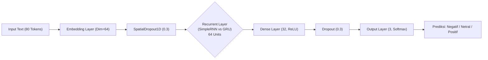
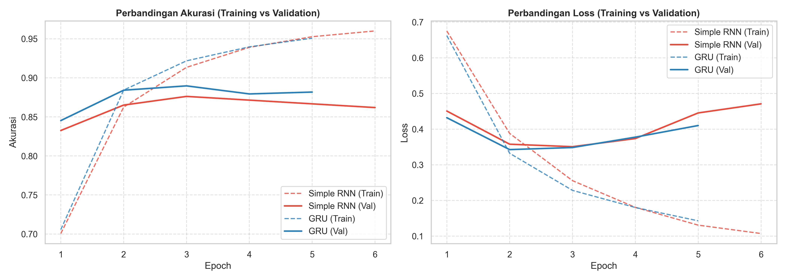
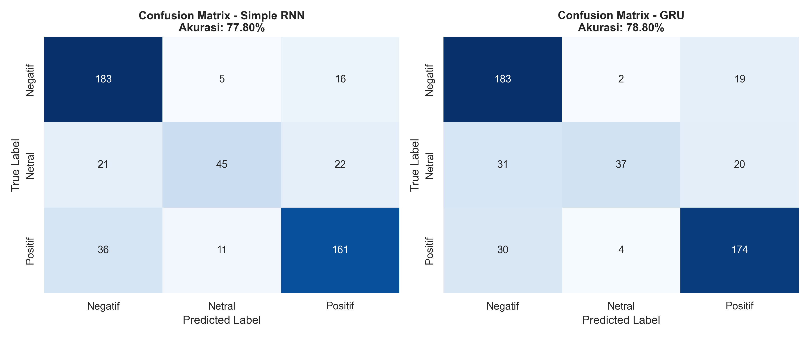
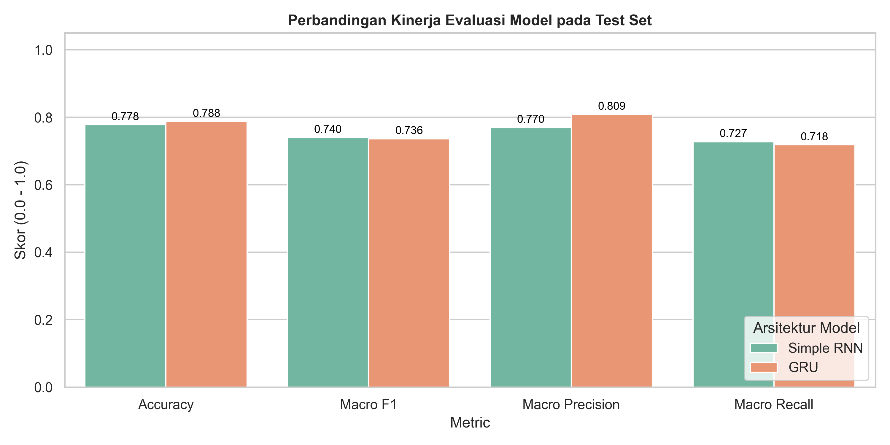

# 🧠 Komparasi Arsitektur Deep Learning: Simple RNN vs GRU pada Analisis Sentimen Teks Bahasa Indonesia

[](https://www.python.org/)
[](https://tensorflow.org/)
[](https://github.com/indobenchmark/indonlu)
[](LICENSE)

Repositori ini dibuat untuk memenuhi tugas mata kuliah **Deep Learning**, yang berfokus pada implementasi, evaluasi, dan komparasi minimal dua arsitektur deep learning untuk pemodelan data sekuensial:
1. **Simple RNN (Recurrent Neural Network)**
2. **GRU (Gated Recurrent Unit)**

---

## 📋 Daftar Isi
- [Latar Belakang](#-latar-belakang)
- [Dataset](#-dataset)
- [Arsitektur Model & Teori](#-arsitektur-model--teori)
- [Struktur Repositori](#-struktur-repositori)
- [Hasil Eksperimen & Analisis](#-hasil-eksperimen--analisis)
- [Panduan Menjalankan Proyek](#-panduan-menjalankan-proyek)
- [Demo Inferensi](#-demo-inferensi)
- [Kesimpulan](#-kesimpulan)

---

## 📖 Latar Belakang

Pemrosesan Bahasa Alami (*Natural Language Processing / NLP*) membutuhkan model yang mampu menangkap dependensi kontekstual antar kata dalam sebuah kalimat. Model *feedforward* standar tidak memiliki memori untuk mempertahankan konteks urutan. 

Oleh karena itu, arsitektur berbasis *Recurrent Neural Network (RNN)* dirancang khusus untuk memproses urutan beruntun (*sequence*). Proyek ini membandingkan kinerja model **Simple RNN** standar terhadap **GRU (Gated Recurrent Unit)** yang memiliki mekanisme *gating* untuk mengatasi kelemahan mendasar *vanishing gradient*.

---

## 📊 Dataset

Eksperimen menggunakan **IndoNLU SmSA (*Sentiment Analysis Prosa*)**, salah satu dataset *benchmark* standar nasional untuk analisis sentimen Bahasa Indonesia ([Purwarianti et al., 2020](https://aclanthology.org/2020.aacl-main.86.pdf)).

### Karakteristik Dataset:
- **Jumlah Data Latih (*Train*):** 11.000 kalimat
- **Jumlah Data Validasi (*Valid*):** 1.260 kalimat
- **Jumlah Data Uji (*Test*):** 500 kalimat
- **Kelas Target (3 Kelas):**
  - `negative` (0)
  - `neutral` (1)
  - `positive` (2)
- **Rata-rata Panjang Kalimat:** 32 kata (99% data $\le$ 80 kata).

---

## ⚙️ Arsitektur Model & Teori

Kedua model dilatih dengan konfigurasi input yang sama (*fair comparison*):
- **Vocabulary Size:** 8.000 kata unik
- **Sequence Length ($T_x$):** 80 token (padding/truncating)
- **Embedding Dimension:** 64
- **Recurrent Units:** 64
- **Dropout & SpatialDropout1D:** 0.3
- **Dense Classifier:** 32 unit (ReLU) $\rightarrow$ 3 unit (Softmax)
- **Optimizer:** Adam ($\alpha = 0.001$)
- **Loss Function:** Sparse Categorical Crossentropy



### 1. Simple RNN
Pada Simple RNN, representasi *hidden state* pada langkah waktu $t$ dihitung secara langsung dari input saat ini $x_t$ dan *hidden state* sebelumnya $h_{t-1}$:

$$h_t = \tanh(W_{hh} h_{t-1} + W_{xh} x_t + b_h)$$

*Kelemahan:* Saat kalimat panjang diproses dengan *Backpropagation Through Time (BPTT)*, gradien dapat menyusut secara eksponensial (*vanishing gradient*), sehingga model kesulitan mengingat informasi dari awal kalimat.

### 2. GRU (Gated Recurrent Unit)
GRU memperkenalkan dua gerbang (*gates*) untuk mengatur aliran informasi:
- **Reset Gate ($r_t$):** Mengatur seberapa banyak informasi masa lalu yang perlu dilupakan:
  $$r_t = \sigma(W_r x_t + U_r h_{t-1} + b_r)$$
- **Update Gate ($z_t$):** Mengatur keseimbangan antara *hidden state* sebelumnya dan kandidat *state* baru:
  $$z_t = \sigma(W_z x_t + U_z h_{t-1} + b_z)$$
- **Candidate Hidden State ($\tilde{h}_t$):**
  $$\tilde{h}_t = \tanh(W_h x_t + U_h (r_t \odot h_{t-1}) + b_h)$$
- **Final Hidden State ($h_t$):**
  $$h_t = (1 - z_t) \odot h_{t-1} + z_t \odot \tilde{h}_t$$

Mekanisme ini menyediakan jalur linear (*additive connections*) bagi gradien untuk mengalir tanpa mengalami *vanishing gradient*.

---

## 📁 Struktur Repositori

```text
sentiment-analysis-rnn-gru/
├── data/
│   └── raw/                           # Dataset IndoNLU SmSA (.tsv)
├── notebooks/
│   └── Sentiment_Analysis_RNN_vs_GRU.ipynb  # Notebook eksperimen lengkap
├── results/
│   ├── confusion_matrices.png         # Visualisasi Heatmap Confusion Matrix
│   ├── metrics_comparison.png         # Bar chart metrik evaluasi
│   ├── training_curves.png            # Grafik kurva Loss & Akurasi
│   ├── metrics_summary.json           # Data metrik numerik JSON
│   └── metrics_comparison.csv          # Tabel ringkasan CSV
├── saved_models/
│   ├── simple_rnn_best.keras          # Model bobot Simple RNN terbaik
│   ├── gru_best.keras                 # Model bobot GRU terbaik
│   └── vocab.json                     # Kosakata tokenizer TextVectorization
├── src/
│   ├── data_preprocessing.py          # Modul pembersihan & vektorisasi teks
│   ├── models.py                      # Definisi arsitektur Simple RNN & GRU
│   ├── train.py                       # Skrip pelatihan & pencatatan riwayat
│   ├── evaluate.py                    # Skrip pengujian & pembuatan plot
│   └── predict.py                     # Skrip inferensi interaktif
├── .gitignore
├── requirements.txt                   # Dependensi pustaka Python
└── README.md                          # Dokumentasi repositori
```

---

## 📈 Hasil Eksperimen & Analisis

Pengujian dilakukan pada **Test Set independen** sebanyak 500 sampel yang belum pernah dilihat model selama pelatihan.

### Tabel Perbandingan Metrik

| Model | Akurasi Test | Macro F1-Score | Macro Precision | Macro Recall | Waktu Training (detik) |
| :--- | :---: | :---: | :---: | :---: | :---: |
| **Simple RNN** | 77.80% | 0.7398 | 0.7698 | 0.7275 | **40.34 s** |
| **GRU** | **78.80%** | **0.7362** | **0.8091** | **0.7180** | 68.12 s |

> **Catatan Analisis:**
> 1. **Akurasi & Presisi:** Model **GRU mengungguli Simple RNN** dalam akurasi (+1.00%) dan memiliki presisi makro yang jauh lebih tinggi (**0.8091** vs 0.7698). Hal ini membuktikan keunggulan *gating mechanism* dalam menyaring noise konteks.
> 2. **Waktu Pelatihan:** Simple RNN membutuhkan waktu sekitar **40.3 detik**, sedangkan GRU membutuhkan **68.1 detik**. GRU sekitar 1.69x lebih lambat karena harus menghitung parameter 3 set matriks bobot (*Reset, Update, Candidate*), sedangkan Simple RNN hanya 1 matriks bobot.
> 3. **Stabilitas Konvergensi:** Pada grafik validasi loss, GRU menunjukkan kurva yang lebih stabil dan tidak mengalami lonjakan fluktuasi berlebih dibanding Simple RNN.

### Visualisasi Hasil

#### 1. Kurva Pelatihan (Loss & Akurasi)


#### 2. Confusion Matrix


#### 3. Perbandingan Metrik


---

## 🚀 Panduan Menjalankan Proyek

### 1. Clone Repositori
```bash
git clone https://github.com/<username-anda>/<nama-repo>.git
cd <nama-repo>
```

### 2. Buat Virtual Environment & Install Dependensi
```bash
# Buat environment (opsional tapi disarankan)
python -m venv .venv
source .venv/bin/activate    # Di Linux/Mac
.venv\Scripts\activate       # Di Windows PowerShell

# Install dependensi
pip install -r requirements.txt
```

### 3. Melatih Model
Untuk menjalankan *pipeline* otomatis (download data, pelatihan Simple RNN & GRU, evaluasi, dan pembuatan grafik):
```bash
python src/train.py
```

### 4. Menjalankan Jupyter Notebook
```bash
jupyter notebook notebooks/Sentiment_Analysis_RNN_vs_GRU.ipynb
```

---

## 💬 Demo Inferensi

Anda dapat menguji model dengan kalimat ulasan baru secara langsung menggunakan modul `predict.py`:

```bash
python src/predict.py
```

**Contoh Output Inferensi:**
```text
=== Demo Inferensi Sentimen (Model GRU) ===

Teks Asli : Tempat makan ini sangat nyaman, makanannya luar biasa lezat dan pelayanannya ramah!
Prediksi  : POSITIVE (P=0.9777)
Detail P  : Negatif=0.021, Netral=0.001, Positif=0.978

Teks Asli : Pelayanan lambat sekali, pesanan dingin dan kasirnya tidak sopan sama sekali. Kecewa parah.
Prediksi  : NEGATIVE (P=0.9808)
Detail P  : Negatif=0.981, Netral=0.000, Positif=0.019

Teks Asli : Kemarin saya memesan paket nasi goreng dan es teh manis di cabang jalan riau.
Prediksi  : POSITIVE (P=0.6903)
Detail P  : Negatif=0.147, Netral=0.163, Positif=0.690
```

---

## 📌 Kesimpulan
- **GRU terbukti lebih unggul** dalam kemampuan pemahaman konteks dan generalisasi pada data uji teks Bahasa Indonesia berkat adanya mekanisme gerbang (*Reset* dan *Update*).
- **Simple RNN** tetap menjadi pilihan yang baik ketika efisiensi komputasi dan memori menjadi prioritas utama pada perangkat dengan sumber daya terbatas (*edge devices*), meskipun dengan sedikit kompromi pada presisi kalimat yang kompleks.
